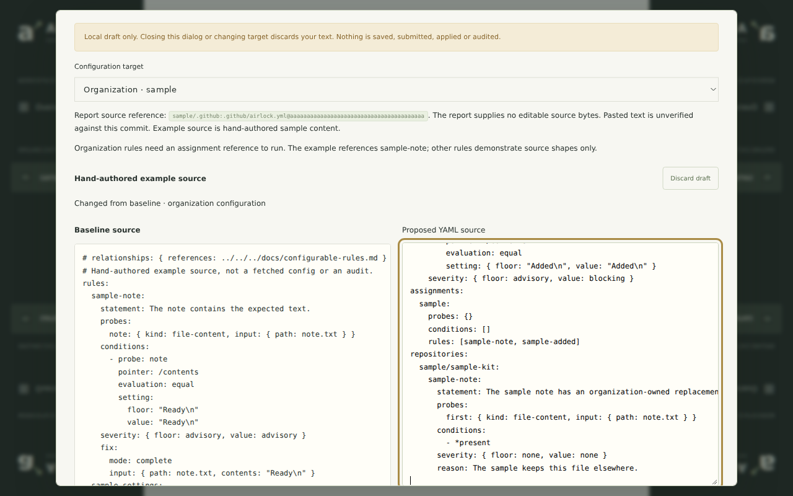

---
relationships:
  references: ../docs/hosted-browser.md
---

# Airlock hosted browser

Run `pnpm install --frozen-lockfile`, then `pnpm dev`. Open
<http://localhost:5178> for the local actual-engine fixture preview. The fixture
passes through the typed adapter, report store, API and browser. Missing audit
time stays unavailable; no GitHub or identity service is connected.

`pnpm check` runs type checks, focused tests and the browser build.
`pnpm build && pnpm preview` serves the same browser through a local Cloudflare
Worker at <http://localhost:8788>.

The unedited fixture and its source/hash provenance are in `fixtures/`. See
[fixture refresh](../docs/hosted-browser.md#fixture-refresh) before regenerating it.

Read [the hosted browser contract](../docs/hosted-browser.md) for boundaries and
unconnected integrations. This package has no public deployment script.

Inside an organization, use **Rules → Draft rule configuration** for a local
full-YAML editor. Start an example or paste source, edit rules and assignment
references, then inspect the baseline and exact proposed text. Drafts are
discarded on close or target change. Checks are limited to local syntax and
envelope structure; no audit or proposal is submitted. See
[local rule drafts](../docs/hosted-browser.md#local-rule-drafts) for source and
validation limits and the focused core consumer.

